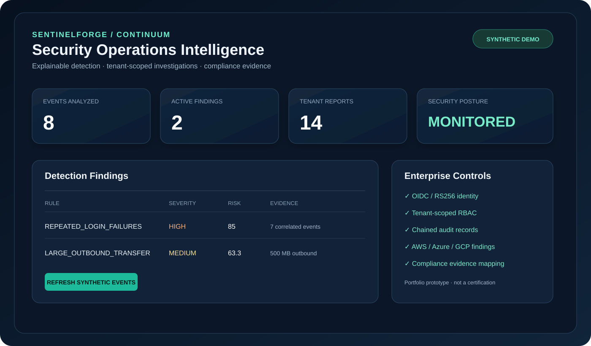
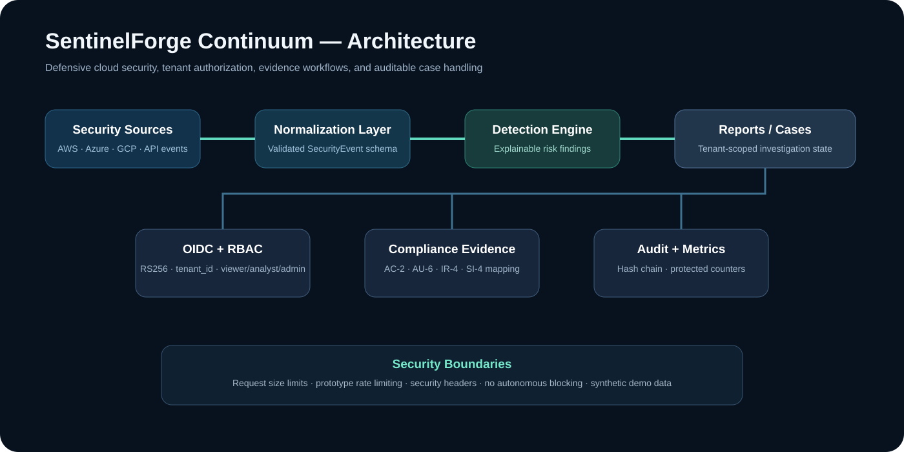

# SentinelForge Continuum



## Executive summary
SentinelForge Continuum is an enterprise-style defensive cybersecurity and continuous-compliance prototype built to demonstrate security engineering, cloud monitoring, explainable detections, OIDC tenant isolation, role-based access control, incident case workflows, auditability, and evidence-oriented compliance analysis. It accepts synthetic or exported security findings, normalizes them into a common event model, generates analyst-review findings, persists tenant-scoped investigation records, and exposes a browser dashboard plus secured APIs.

**Portfolio value:** demonstrates backend engineering, cybersecurity architecture, cloud-security normalization, authentication/authorization, API design, persistence, Docker, automated CI, and security-focused testing in one project.

An unclassified, **synthetic-data defensive cybersecurity and compliance intelligence prototype**. Provides an explainable detection engine, bounded security-event analysis API, immutable-input SHA-256 evidence digests, and a browser dashboard.

## Architecture



## What this project demonstrates
- Defensive security-event analytics with explainable rule-based findings.
- AWS Security Hub, Microsoft Defender for Cloud, and GCP Security Command Center normalization.
- RS256 OIDC verification with signed tenant claims and viewer/analyst/admin RBAC.
- Tenant-scoped reports, incident cases, compliance evidence assessments, and chained audit records.
- Protected metrics, security headers, request-size limits, and prototype rate limiting.
- Dockerized runtime plus GitHub Actions lint, unit/API tests, and container smoke tests.

## Quick start

```bash
docker compose up --build
# Dashboard: http://localhost:8000
# API docs: http://localhost:8000/docs
```

To test locally:

```bash
python -m pip install -e ".[dev]"
ruff check src tests
pytest -q
```

## Endpoints
- `GET /health`: health status
- `GET /api/v1/demo`: fictional events and explanation-backed findings
- `POST /api/v1/analyze`: API-key-protected analysis of up to 10,000 events
- `GET /`: static SOC demonstration dashboard

Configure `SENTINELFORGE_API_KEY` with a securely generated secret of at least 24 characters before calling the ingestion API:

```bash
export SENTINELFORGE_API_KEY='replace-with-strong-random-secret'
curl -X POST localhost:8000/api/v1/analyze \
  -H "X-API-Key: $SENTINELFORGE_API_KEY" \
  -H "Content-Type: application/json" \
  -d '{"events":[]}'
```

## Detection models
- Failed-login bursts: five or more failed logins by the same actor and source IP within ten minutes.
- Large outbound transfers: successful outbound transfers of 100 MB or greater.
- Reproducible, interpretable scoring with explicit rule IDs and event identifiers.

No autonomous blocking, offensive activity, production claims or live customer data is included.

## Security and limitations
The demo endpoints are deliberately public. Analysis requires an API key but does **not** yet offer multi-tenant OIDC, RBAC, rate limiting, secure storage, immutable logging, SIEM connectors, real model calibration, certification or security assessment. Do **not** expose the demo service to the Internet or ingest regulated/controlled data. Digest hashes alone are not proof of provenance.

## Roadmap
- [x] Defensive event validation and explainable detections
- [x] API-key protected analysis, static dashboard and tests
- [x] Docker container and GitHub Actions
- [x] OIDC identity, signed tenant claims, and viewer/analyst/admin authorization
- [x] Tenant-scoped report persistence, case workflow, and chained audit records
- [x] Evidence-oriented control mappings and auditable compliance assessments
- [x] AWS Security Hub / Azure Defender / GCP SCC normalization, protected metrics, headers, body/rate guards
- [ ] Independent validation and live integrations

This project is a portfolio-quality foundation, **not** a certified SOC or CMMC compliance product.

## Authenticated investigation workflow (new)
Set `SENTINELFORGE_OIDC_ISSUER`, `SENTINELFORGE_OIDC_AUDIENCE`, and `SENTINELFORGE_OIDC_JWKS_URL` to a trusted identity provider's configuration. Bearer tokens must be RS256-signed and include a trusted `tenant_id` claim. Routes: `POST /api/v1/secure/analyze`, `GET /api/v1/secure/reports`, `POST /api/v1/secure/cases`, `GET /api/v1/secure/cases`. SQLite persistence defaults to `/tmp/sentinelforge.db`; set `SENTINELFORGE_DB_PATH` to a writable durable volume path. These are development-only integrations. OIDC role enforcement, cloud finding normalization, compliance mappings, chained local audit records, protected metrics, and prototype HTTP guards are implemented. Production still requires identity-provider integration testing, gateway/WAF controls, centralized SIEM transport, a production database, backup/restore exercises, tamper-resistant external audit storage, secret rotation, load testing, and independent security review. Do not store customer or controlled data in this prototype.


## Enterprise security API
OIDC-secured routes derive the tenant exclusively from the verified `tenant_id` token claim and apply `viewer`, `analyst`, or `admin` role hierarchy. Analysts can analyze native events, normalize AWS Security Hub / Microsoft Defender for Cloud / GCP Security Command Center findings, create cases, and assess control evidence. Viewers can inspect tenant reports, cases, and audit metadata. `GET /metrics` is disabled unless `SENTINELFORGE_METRICS_TOKEN` is set.

These integrations accept exported provider findings; they do not automatically connect to a customer's cloud account or claim that a control is effective. The SQLite audit hash chain is tamper-evident only within the local prototype and is not immutable external storage.
